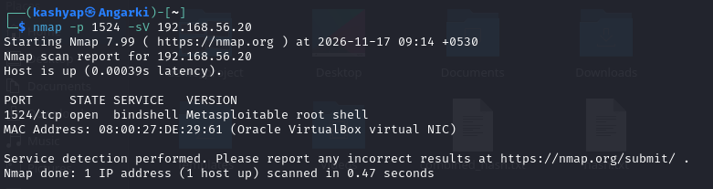
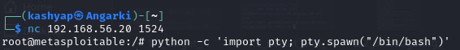

# Deep Dive into Port 1524 and System Takeover

## Overview

This project demonstrates how a single exposed network service can significantly impact the security posture of a system when improperly configured. The assessment focuses on TCP Port 1524 exposed on the Metasploitable 2 virtual machine and examines how information gathered during service enumeration can lead to direct system access within a controlled laboratory environment.

The project begins by identifying and validating the service operating on Port 1524 before progressing into system reconnaissance, credential discovery, and password analysis. Following successful access validation, internal reconnaissance techniques are used to identify operating-system characteristics, running services, active processes, and credential-related artifacts stored on the target system.

The assessment concludes with password-hash extraction and credential verification using John the Ripper, demonstrating how exposed services and weak authentication practices can contribute to wider system compromise when combined throughout an attack lifecycle.

All activities were conducted within an isolated VirtualBox Host-Only laboratory environment using intentionally vulnerable systems for educational and cybersecurity research purposes.

## Project Objectives

- Analyze the service exposed on TCP Port 1524.
- Validate service accessibility through manual interaction.
- Examine the security implications of exposed shell services.
- Demonstrate controlled system access within an isolated laboratory environment.
- Perform internal reconnaissance following successful access.
- Enumerate active processes and network services.
- Discover credential-related artifacts within the target system.
- Extract password hashes from authentication repositories.
- Analyze password hashes using John the Ripper.
- Understand the relationship between exposed services and credential compromise.
- Document security observations and defensive considerations throughout the assessment.

## Scope and Ethical Statement

All activities demonstrated in this project were performed within an isolated laboratory environment consisting of a Kali Linux attacker machine and a Metasploitable 2 target machine.

The environment was configured using a VirtualBox Host-Only Adapter network to ensure all assessment activities remained confined to an authorized testing environment.

The purpose of this project is educational and focuses on understanding security weaknesses, attacker methodologies, authentication risks, and defensive security principles within intentionally vulnerable systems.

## Lab Environment

Attacker System
- Operating System: Kali Linux
- Role: Assessment Machine
- Platform: Oracle VirtualBox

Target System
- Operating System: Metasploitable 2
- Role: Vulnerable Target
- Platform: Oracle VirtualBox

Network Configuration
- Network Type: Host-Only Adapter
- Virtualization Platform: Oracle VirtualBox

## Purpose:

- Isolated penetration-testing environment
- Controlled communication between hosts
- No Internet exposure
- Safe cybersecurity research environment

## Tools and Technologies

- Kali Linux
- Metasploitable 2
- Oracle VirtualBox
- Nmap
- Netcat (nc)
- John the Ripper
- Linux Networking Utilities
- Linux Enumeration Commands
- Password Analysis Techniques

## Skills Demonstrated

- Service Enumeration
- Port Analysis
- Service Validation
- Internal System Reconnaissance
- Process Enumeration
- Network Service Discovery
- Credential Discovery
- Password Hash Analysis
- Security Assessment Methodology
- Technical Documentation

# Phase 1 – The Anatomy of the Entry Point (Port 1524)

## Overview

The objective of this phase was to investigate TCP Port 1524 and determine the nature of the service exposed by the target system. Service identification and manual validation were performed to understand the functionality, accessibility, and security implications of the discovered service.

This phase represents the initial transition from reconnaissance to access validation. By examining the service associated with Port 1524, the assessment aimed to determine whether the exposed service provided a viable entry point into the target environment.

Sub Step 1: Service Identification and Banner Enumeration

Command Executed

Identifying the service running on TCP Port 1524...
- sudo nmap -p 1524 -sV 192.168.56.20

Results

Observation

Service enumeration confirmed that TCP Port 1524 was open and accessible on the target system.

The scan identified:

1524/tcp open bindshell

and further identified the service as:

Metasploitable root shell

The host was confirmed as reachable, and service fingerprinting successfully determined the nature of the application exposed on the port.

Analysis

The service operating on Port 1524 differed significantly from conventional network services such as HTTP, FTP, or SSH. Rather than providing access to a specific application, the identified service appeared to expose direct operating-system interaction capabilities.

This discovery immediately elevated the importance of Port 1524 within the assessment because exposed shell services frequently represent high-risk attack surfaces. Unlike traditional services that restrict users to predefined functionality, shell services may provide direct command execution capabilities on the target host.

The findings demonstrate the importance of service-enumeration activities during reconnaissance because accurate service identification allows analysts to prioritize targets based on potential security impact.

Sub Step 2: Manual Service Validation and Privilege Verification

Command Executed

Connecting directly to the discovered service...
- nc 192.168.56.20 1524

Verification Commands

- whoami
- id

Results

Observation

A direct connection was successfully established to the service exposed on Port 1524.

Following connection, identity-verification commands returned:

root

and

uid=0(root) gid=0(root)

confirming that the service was operating under the highest privilege level available on the target system.

Analysis

Manual interaction validated the results obtained during service enumeration and confirmed that the exposed service was functional and accessible.

The privilege-verification results demonstrated that interactions with the service occurred with administrative permissions. From a security perspective, services operating with elevated privileges represent a significant risk because successful access may provide unrestricted visibility into host resources, processes, configurations, and authentication data.

This stage highlights the relationship between:

Service Discovery | 
Service Validation |
Privilege Verification | 
Security Impact Assessment

The assessment therefore established Port 1524 as a critical entry point requiring further investigation during the subsequent phases of system reconnaissance and credential analysis.

## Phase 1 Conclusion

Analysis of TCP Port 1524 revealed that the target system exposed a network-accessible shell service. Service enumeration successfully identified the nature of the service, while manual validation confirmed direct access to the target operating system.

Privilege verification demonstrated that interactions with the service occurred under administrative privileges, substantially increasing the potential security impact of the exposed service.

The findings obtained during this phase establish the foundation for the next stage of the assessment, where internal reconnaissance activities will be performed to understand the target environment, identify running services, and locate credential-related artifacts.

# Phase 2 – System Reconnaissance and Discovery

## Overview

Following successful access through the service exposed on TCP Port 1524, internal reconnaissance activities were performed to understand the target environment from the operating system's perspective. The objective of this phase was to identify active network services, enumerate running processes, and establish a clearer understanding of how the target system was configured internally.

Unlike external reconnaissance, which relies on information visible from the network, internal reconnaissance provides direct visibility into the operating system, running applications, service ownership, and local network configuration.

Sub Step 1: Upgrading to a Stable Interactive Shell

Command Executed

Upgrading the interactive shell...
- python -c 'import pty; pty.spawn("/bin/bash")'

Results

Observation

The shell obtained through Port 1524 was upgraded into a more stable interactive terminal session.

The command successfully spawned a Bash shell, allowing improved interaction with the target system and enabling execution of subsequent reconnaissance activities.

Analysis

Initial shells obtained through exposed services often provide limited functionality. Upgrading the session to a fully interactive shell improves usability and allows better command execution, process enumeration, service analysis, and filesystem navigation.

This step establishes a more reliable operating environment for performing post-access reconnaissance activities and simulates how administrators and analysts interact with Linux systems through a local terminal.

Sub Step 2: Mapping Active Network Listeners

Command Executed

Enumerating active network services...
- netstat -antp

Results

Observation

The command identified numerous listening services and active network sockets operating on the target host.

Examples included:

- FTP (21)
- SSH (22)
- DNS (53)
- HTTP (80)
- MySQL (3306)
- PostgreSQL (5432)
- Tomcat (8180)
- Java RMI (1099)
- IRC (6667)
- VNC (5900)
- Samba (139/445)

The output also revealed active communication sessions associated with the established shell connection.

Analysis

Network service enumeration provides visibility into services directly from the host itself rather than from an external perspective.

The results confirmed many of the services previously identified during Nmap reconnaissance and demonstrated strong correlation between external reconnaissance findings and internal system state.

This process enables analysts to determine which services are actively listening, the ports on which they operate, and the processes responsible for those services.

Sub Step 3: Identifying Local Daemons and Critical Services

Command Executed

Enumerating selected service processes...
ps aux | grep -E "mysql|bind|apache"

Results

Observation

The process list identified several critical services running on the target system.

Examples included:

- MySQL Database Service
- BIND DNS Service
- Apache Web Server
- Tomcat Application Server

Process ownership information and execution parameters were also visible.

Analysis

Process enumeration provides insight into applications actively running within the operating system and reveals services that support the functionality identified during service enumeration.

The identified daemons confirmed the presence of multiple infrastructure services, including database services, DNS services, application servers, and web services.

Understanding which services are active assists in identifying locations where sensitive information, configuration files, and authentication artifacts may be stored.

Sub Step 4: Service Fingerprinting and Banner Verification

Command Executed

Investigating the database service through direct interaction...
curl http://127.0.0.1:3306

Results

Observation

A connection attempt was made to the service listening on TCP Port 3306 from the local host.

Instead of returning web content, the service responded with protocol-specific information including:

5.0.51a-3ubuntu5

along with additional protocol negotiation data associated with the database service.

Analysis

Banner grabbing is a reconnaissance technique used to identify software versions and gather service-specific information. Although the request was sent using an HTTP-style command, the response exposed identifying details from the database service itself.

The version information confirmed the presence of a MySQL service running on the system and provided additional verification of the findings obtained through previous enumeration activities.

Version identification assists analysts in correlating services, validating reconnaissance findings, understanding software deployments, and prioritizing areas for further investigation.

## Phase 2 Conclusion

Internal reconnaissance successfully expanded upon the findings collected during external service enumeration. By obtaining direct visibility into network listeners, running processes, and application services, the assessment established a detailed understanding of the target environment.

The results confirmed the presence of multiple network-accessible services, including database servers, web applications, DNS infrastructure, and remote-access mechanisms. Correlation between Nmap reconnaissance and host-level enumeration demonstrated how information gathered before access can be validated and expanded after entering a system.

The service fingerprinting activities further confirmed the software implementations operating on the target host and provided additional context regarding the environment's architecture.

The findings obtained during this phase establish the foundation for the next stage of the assessment, where credential repositories and authentication artifacts will be examined to understand the security implications of privileged access and exposed authentication data.